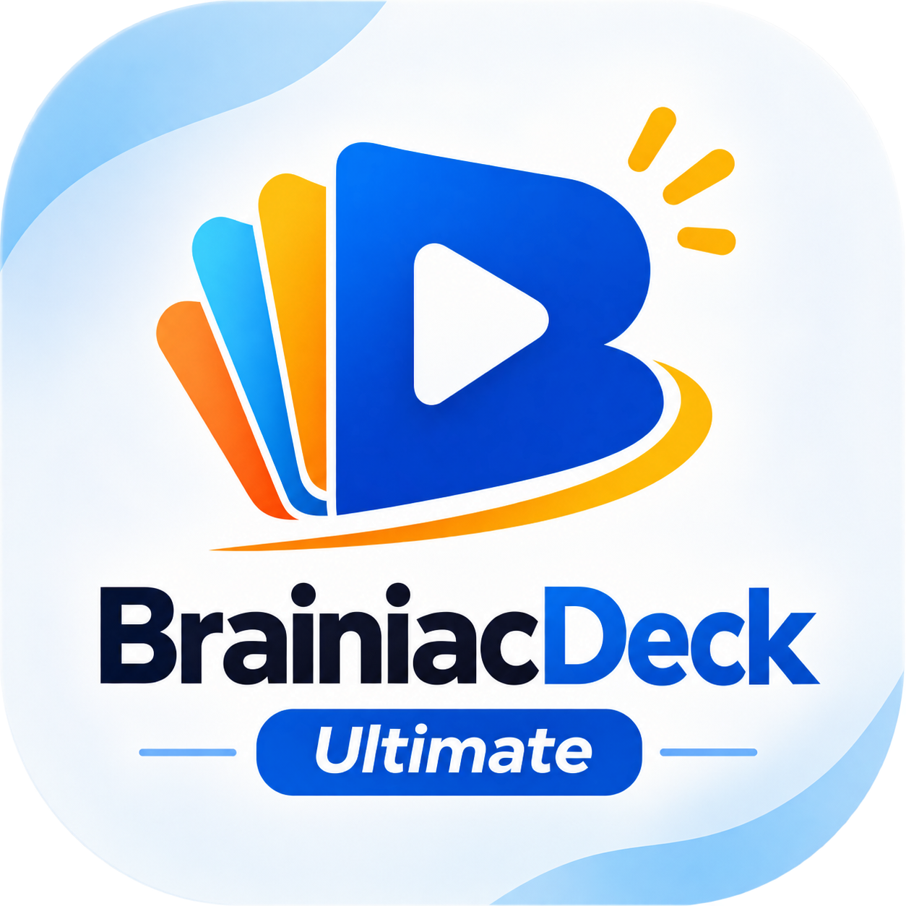
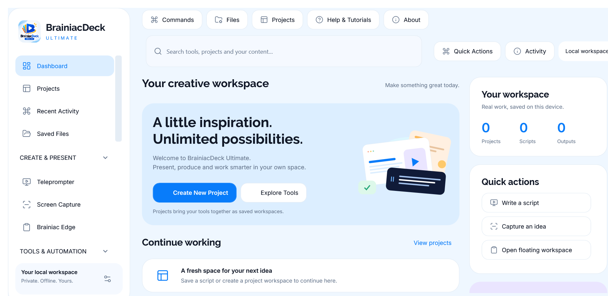
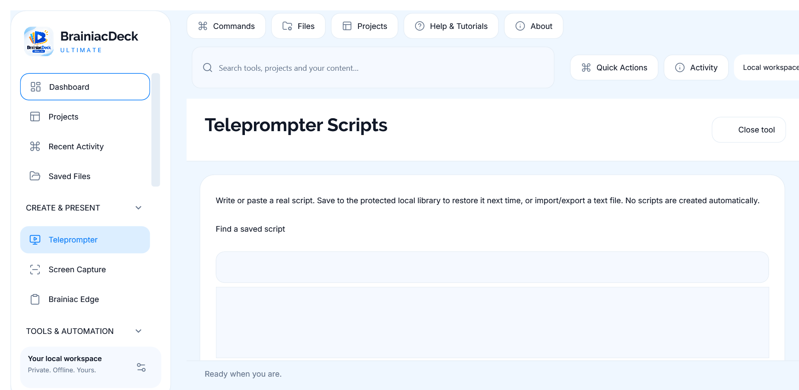
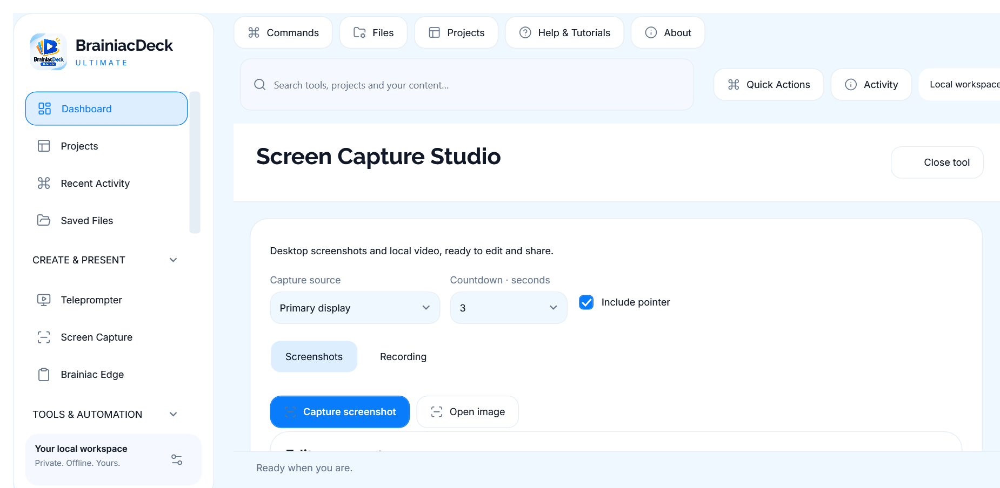
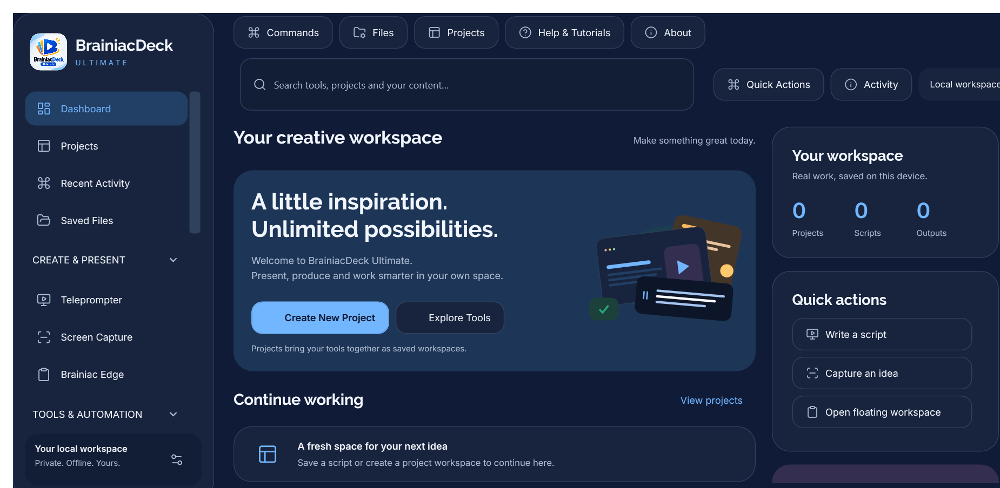

<div align="center">



# BrainiacDeck Ultimate

### One Desktop. Unlimited Possibilities.

A native Windows workspace for presenting, capturing, organizing and working with your files.

[](#getting-started)
[](#build-from-source)
[](#architecture)
[](https://github.com/brainiacweb-tech/BrainiacDeck-Ultimate/actions/workflows/windows.yml)
[](LICENSE)

**[Download preview](https://github.com/brainiacweb-tech/BrainiacDeck-Ultimate/releases/tag/v0.2.0-preview.1)** · **[Feature tour](#feature-tour)** · **[Build & run](#build-from-source)** · **[Help](docs/HELP.md)** · **[Privacy](PRIVACY.md)** · **[Report an issue](https://github.com/brainiacweb-tech/BrainiacDeck-Ultimate/issues)**



<sub>Actual application interface. New installations start with your own empty workspace.</sub>

</div>

---

## Your desktop, brought together

Write a script, prepare a presentation, capture an idea, convert a batch of images or keep a useful snippet nearby. BrainiacDeck puts these tools in one Windows application, with ordinary tools opening inside the main workspace.

No required account. No seeded projects or invented activity. Core processing happens on your device. The floating Teleprompter and Brainiac Edge shelf appear when you choose to use them.

> [!NOTE]
> **Version 0.2.0 is a development candidate.** The assigned Microsoft Store identity is configured, but Store certification and installed-package acceptance are pending. This repository does not claim that a certified Store release is available.

## Contents

- [Feature tour](#feature-tour)
- [Getting started](#getting-started)
- [Build from source](#build-from-source)
- [Architecture](#architecture)
- [Quality and verification](#quality-and-verification)
- [Privacy and fresh installs](#privacy-and-fresh-installs)
- [Microsoft Store packaging](#microsoft-store-packaging)
- [Known limits](#known-limits)
- [Contributing](#contributing)
- [License and acknowledgements](#license-and-acknowledgements)

## Feature tour

| Tool | What you can do |
|---|---|
| **Teleprompter** | Write, import and save scripts; adjust speed, font, alignment, reading guide and mirroring; launch a floating reading overlay or fullscreen mode. |
| **Screen Capture** | Capture the desktop, a display, foreground window or region. Crop, annotate, redact, recognize text locally and export PNG, JPEG or PDF. |
| **Screen recording** | Record H.264 MP4 clips with pause/resume, then trim, crop or zoom in the existing video editor. Exports are video-only. |
| **Brainiac Edge** | Reveal a floating shelf from a screen edge or configurable shortcut. Pin notes, code, URLs, images and file references; search, tag, favourite and detach content cards. |
| **File Converter** | Convert supported PNG, JPEG, BMP, TIFF and GIF images, resize batches, adjust JPEG quality and create or manipulate PDFs. |
| **Clipboard Shelf** | Manually collect snippets or explicitly enable session monitoring. Search, pin, transform text and optionally save the shelf with Windows account encryption. |
| **File Toolkit** | Verify SHA-256/SHA-512, inspect files, preview and undo numbered renames, scan duplicates and work with ZIP archives. |
| **Workflow Studio** | Review and run manual Copy, SHA-256 and ZIP workflows using approved input/output folders. |
| **Workspaces** | Save named collections of tools and choose related Edge pin collections. |
| **Command Center** | Search local actions, keep favourites and launch tools using keyboard navigation or a configurable global shortcut. |

### Present with confidence

1. Open **Teleprompter** inside the main workspace.
2. Write or import your own script and save it to the script library.
3. Select **Use script in overlay**, then adjust reading preferences from the floating reader.



### Capture, annotate and export

1. Open **Screen Capture** and choose the target and countdown.
2. Capture your screen or open an existing image.
3. Crop or annotate it, then copy, export, run local OCR or pin it to Brainiac Edge.



### Keep an idea within reach

Open **Brainiac Edge**, or use its configured edge gesture or shortcut. Add your own note, drop a file, or explicitly pin an item from Clipboard Shelf. File pins keep a reference to the original; they do not move or delete it.

### Work comfortably in light or dark

Choose your appearance in **Settings** and save preferences. Tool pages share the same design system, while the native title bar follows the selected theme.



## Getting started

**Requirements:** Windows 11, x64. Source builds need the .NET 10 SDK. Self-contained published builds include their runtime.

Download the [Windows x64 preview](https://github.com/brainiacweb-tech/BrainiacDeck-Ultimate/releases/tag/v0.2.0-preview.1), choose the **portable ZIP**, extract the complete folder and run `BrainiacDesk.App.exe`. The preview is unsigned. The separately attached **UNSIGNED MSIX** is for package/submission review and is not a signed consumer installer.

You can also build locally using the instructions below. Successful GitHub Actions runs provide development-build artifacts on the [Actions page](https://github.com/brainiacweb-tech/BrainiacDeck-Ultimate/actions). Neither a GitHub preview nor an Actions artifact implies Microsoft Store certification.

Keep a published application's entire folder together, then launch `BrainiacDesk.App.exe`. The internal executable and namespaces retain their existing `BrainiacDesk` names for compatibility; the visible product is BrainiacDeck Ultimate.

## Build from source

```powershell
git clone https://github.com/brainiacweb-tech/BrainiacDeck-Ultimate.git
cd BrainiacDeck-Ultimate
dotnet restore BrainiacDesk.slnx
dotnet build BrainiacDesk.slnx -c Release
dotnet run --project src/BrainiacDesk.App -c Release
```

Publish a self-contained Windows build:

```powershell
dotnet publish src/BrainiacDesk.App -c Release -r win-x64 --self-contained true -o artifacts/portable
.\artifacts\portable\BrainiacDesk.App.exe
```

The repository launcher uses a verified local build when present and falls back to `artifacts/portable`. Build output, local databases, private keys and test profiles are excluded from version control.

## Architecture

The application stays on **C# / .NET 10, WPF, MVVM, CommunityToolkit.Mvvm and SQLite**. No Electron or WinUI migration is involved.

| Location | Responsibility |
|---|---|
| `src/BrainiacDesk.App` | Main shell, shared WPF design system, tool interfaces, capture/media and native Windows integration. |
| `src/BrainiacDesk.Core` | Settings, domain contracts, file/workflow operations and Edge models. |
| `src/BrainiacDesk.Infrastructure` | SQLite preferences and additive Edge persistence/search. |
| `src/BrainiacDesk.Package` | Microsoft Store manifest, assigned identity and package icons. |
| `tests` | Executable Core and Windows integration test harnesses. |
| `scripts` | Builds, UI smoke tests, asset generation and Store packaging/validation. |
| `store` | Public package identity, listing copy, privacy page and certification/acceptance notes. |
| `docs` | Help, architecture, dependency notices and implementation reports. |

Existing conversion, PDF, OCR, clipboard and workspace functionality is reused across modules. Ordinary tools are hosted in the main shell; floating surfaces keep their explicit desktop role.

## Quality and verification

The latest recorded local release run passed **241 executable checks**, with **11 additional fresh-install checks** confirming empty initial state, a zero-warning Release build, dependency vulnerability audit and published-app restart smoke test. See [testing instructions](TESTING.md) and the [Store readiness report](docs/STORE-READINESS-REPORT.md) for evidence and limits. The live build badge above reports GitHub CI separately.

```powershell
dotnet run --project tests/BrainiacDesk.Tests -c Release
dotnet run --project tests/BrainiacDesk.WindowsTests -c Release
pwsh -File scripts/verify-release.ps1 -Interactive -Output artifacts/verified
```

These are executable test harnesses; `dotnet test` alone does not run them. Synthetic 125%, 150% and 200% image renders are checked, but they do not replace physical mixed-DPI monitor tests. Automation-name checks do not establish full screen-reader accessibility.

## Privacy and fresh installs

- A new profile starts without scripts, projects, Edge pins, clipboard history or operation history. Dashboard information comes from actual saved state.
- Test fixtures exist only under `tests` and temporary test profiles. They are not shipped as user content.
- Clipboard monitoring requires explicit session consent. Optional shelf persistence and saved scripts use Windows account data protection.
- Edge pin text, paths, tags and OCR text are stored locally without account encryption. Managed screenshots and JSON backups may contain private content.
- Core processing is local. There is no required account, telemetry, cloud OCR or external AI processing.
- Opening a tool does not erase existing work. Cleanup never deletes the original files referenced by pins.

Read the complete [privacy policy](PRIVACY.md). For support, [open an issue](https://github.com/brainiacweb-tech/BrainiacDeck-Ultimate/issues) with non-private reproduction details.

## Microsoft Store packaging

The assigned identity is **`KusiFrancis.BrainiacDeckUltimate`**, published as **Kusi Francis**. Public identity values are configuration, not signing credentials.

```powershell
pwsh -File scripts/store-preflight.ps1
pwsh -File scripts/prepare-store-content.ps1
pwsh -File scripts/package-msix.ps1
```

Packaging requires Windows SDK MakeAppx. Local test signing uses a separate matching trusted certificate; private keys are never committed. Store signing, local installation tests, WACK and Microsoft certification are distinct steps.

See [submission instructions](docs/STORE_SUBMISSION.md) and the [acceptance checklist](store/ACCEPTANCE.md). Building an MSIX does not mean that Microsoft has approved it.

## Known limits

- Recording and edited MP4 exports contain no audio.
- GIF/TIFF conversion exports the first frame; Markdown-to-PDF preserves source text rather than rich Markdown layout.
- Workflows run manually; scheduled automation and folder watchers are not implemented.
- OCR and optional offline voice following depend on installed Windows language components. Voice following also needs microphone consent.
- Windows capture exclusion is a request and cannot guarantee exclusion from every sharing application.
- Physical DPI transitions, complete accessibility assessment, final installed-MSIX lifecycle tests and WACK acceptance remain release gates.

## Contributing

Read [the architecture](docs/ARCHITECTURE.md) and [testing guide](TESTING.md), then open an issue or pull request. Preserve existing modules and stored data, use the shared design tokens, and include meaningful validation for behavior changes. Never commit personal files, production databases, credentials or signing keys.

## License and acknowledgements

Released under the [MIT License](LICENSE). Developed by **Francis Kusi**.

Bundled fonts, icons and dependencies retain their required notices. Brainiac Edge's reference analysis and reused material preserve Tack's MIT notice. See the [dependency inventory](docs/DEPENDENCIES.md) and [third-party notices](docs/ThirdPartyNotices).

<div align="center">

**Built for a calmer, more capable Windows desktop.**

</div>
